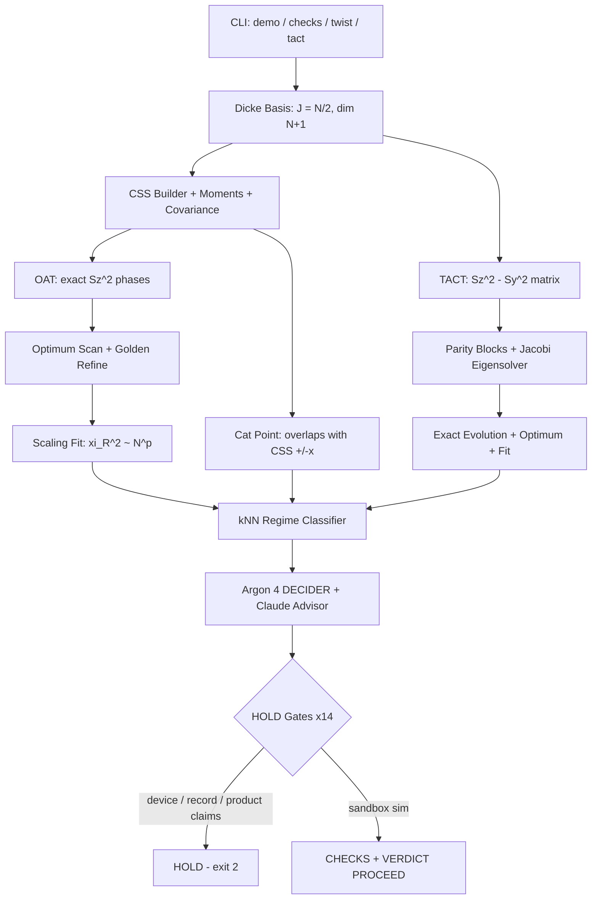
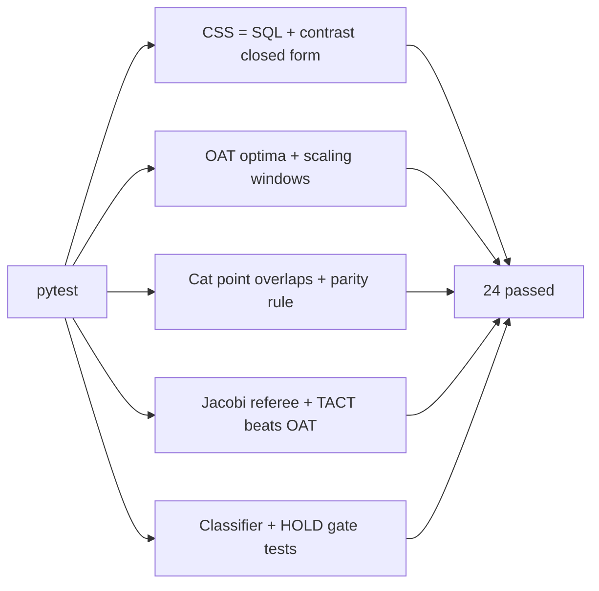
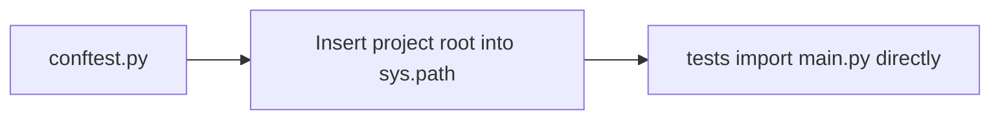
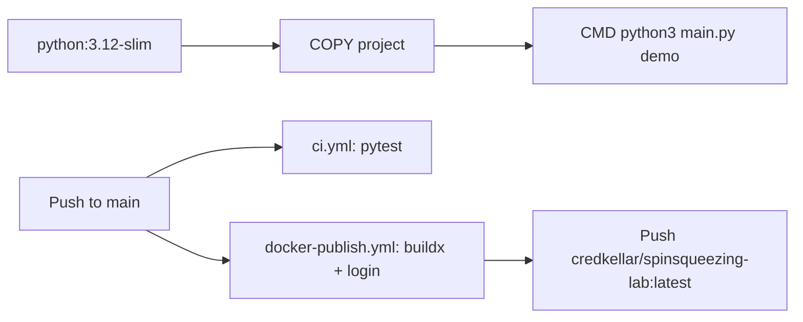

# SpinSqueezing-Lab 🌀⚛️

**Spin Squeezing & Quantum Metrology Lab — One-Axis Twisting, Wineland Parameter, the π/2 Cat, Two-Axis Counter-Twisting** — by Darion Kellar

SpinSqueezing-Lab is an **educational spin-squeezing lab** in ONE pure-Python file. It takes N two-level atoms as one collective spin (J = N/2) in the symmetric **Dicke basis** (dimension N+1), builds the collective operators from scratch, and computes — exactly, never by sampling — the quantities that decide whether a spin state can measure a phase better than the **standard quantum limit (SQL)**:

- A **coherent spin state (CSS)** sits exactly at the SQL: Kitagawa–Ueda ξ² = 1 and Wineland ξ_R² = 1, asserted to machine precision.
- **One-axis twisting** (H = χ·Sz²) shears the noise ellipse until ξ_R² dips to **0.062946 at N=100** — while the contrast quietly falls to 0.881934, which is why only the Wineland parameter (ξ_R² = ξ²/contrast²) prices the gain honestly.
- At χt = π/2 the twisted state is an **exact macroscopic superposition** of the CSS along +x and the CSS along −x (overlaps 0.500000 + 0.500000 = 1.000000) — a spin cat, measured, not asserted.
- **Two-axis counter-twisting** (H = χ(Sz² − Sy²)) beats one-axis twisting at **every N on the grid**, with a fitted scaling exponent of **−0.8745** against OAT's **−0.6943** — both printed next to their ideal values (−1 asymptotic, −2/3).

Honest scope, stated up front: every number here is exact arithmetic on a labelled model. **No atom, laser, clock, or sensor exists in this lab**, no squeezing record is claimed, and no real measurement is certified. Every device / product / record / deployment use sits behind a permanent HOLD gate (14 total). 🔒

[](https://github.com/kimanicollier44-cmyk/SpinSqueezing-Lab/actions/workflows/ci.yml)
[](https://github.com/kimanicollier44-cmyk/SpinSqueezing-Lab/actions/workflows/docker-publish.yml)

> ℹ️ These are the **live** workflow badges for this repo. They activate as soon as the `ci.yml` and `docker-publish.yml` files from the paste pack are pasted into `.github/workflows/` — until then they have nothing to report yet.

## 🧰 Tech Stack Badges & Full Architecture Tech Stack

### 💻 Core Programming Languages & Core Systems


- 🐍 Python 3.12, pure standard library (`math`, `cmath`, `hashlib`, `json`, `sys`) — zero dependencies, zero network, deterministic (double-run byte-identical)
- ⚛️ Dicke-basis core from scratch: collective moments from ⟨S+⟩, ⟨S+²⟩, and ⟨{Sz, S+}⟩, the symmetrised covariance matrix, and the minimum transverse variance as the smallest eigenvalue of the covariance block perpendicular to the mean spin
- 🌀 One-axis twisting is **exact**: Sz² is diagonal in this basis, so evolution is a phase per component; optima are found on a fixed log grid plus a golden-section refinement, identically for every N
- 🔀 Two-axis counter-twisting: the Hamiltonian Sz² − Sy² is real symmetric and couples only m ↔ m, m±2, so it splits into even-m / odd-m blocks, each diagonalised by a **from-scratch cyclic Jacobi eigensolver** (refereed in CHECKS: reconstruction and orthonormality < 1e-9)
- 🧠 TinyML kNN regime classifier (from scratch, stdlib, distance-weighted): sql-limited / squeezed / deep-squeezed / over-twisted from (log₁₀ ξ_R², contrast), labels from the lab's own policy
- 🪑 Council seats: Gemini Argon 4 DECIDER (names-only, tighten-only) + Muse advisor (never overrides HOLD) + Google Flow plan-only (rendered = False, live = 0)

### ⛓️ Web3 & Infrastructure

- 🚫 **Not applicable — honestly.** No blockchain, no Web3, no tokens: the "infrastructure" in this lab is a labelled model of a collective spin inside one offline file. Real metrology infrastructure is a permanent HOLD gate, not a feature. No fake badges here.

### ⚙️ Platform Support & Hardware Architecture


- 🖥️ Pure Python — runs anywhere Python 3.12+ runs (Linux, macOS, Windows), plus the `python:3.12-slim` Docker image
- 🔒 No hardware is controlled, ever: real atoms, lasers, cavities, traps, and clocks are permanent HOLD gates (see the gate table below)

### ⚡ Low-Level Infrastructure & Performance

- 🚫 **No low-level code — honestly.** No C, no C++, no GPU, no compiled extensions: this is one interpreted Python file on purpose, so every variance can be read, checked, and diffed. Performance here means honest algorithms — exact phase evolution for OAT, parity-block Jacobi diagonalisation for TACT, golden-section optima — all deterministic and byte-identical between runs.

### 🛠️ DevOps & Build Tools


- 🐳 Docker (`python:3.12-slim`), GitHub Actions CI + Docker Publish (delivered in the paste pack)
- 🎯 Target image: `credkellar/spinsqueezing-lab:latest`
- 🧪 Tests: `pytest` (24 tests) + the built-in CHECKS suite (49 checks) in `main.py`

### ☁️ Cloud Providers

- 🚫 **None — honestly.** No cloud provider is used or needed: the lab runs fully offline on your own machine or in a local Docker container. Docker Hub appears only as the registry the publish workflow pushes the image to.

## What this does?

1. 🎯 **The reference point — a CSS is exactly at the SQL** — all N atoms point along +x; the transverse variance is J/2, so ξ² = ξ_R² = 1 and contrast = 1, asserted to < 1e-9 for N = 10, 50, 100 (and for a CSS pointing in an arbitrary direction). This is the line every squeezed state has to beat.
2. 🌀 **One-axis twisting, exactly** — H = χ·Sz² is diagonal in the Dicke basis, so evolution is one phase per component: no integrator, no step error. The Sz populations are *frozen* by this evolution (asserted: change < 1e-15) — twisting is pure phase geometry.
3. 📉 **Contrast falls on a closed form** — the mean spin shrinks as |⟨S⟩|/J = cos^(N−1)(χt), asserted against the computed state to < 1e-9 at several times. Squeezing is bought with contrast, and the price list is exact.
4. 🏆 **The OAT optimum table** — golden-refined Wineland optima: ξ_R² = 0.309859 (N=10, μ* = 0.2005) → 0.197897 (N=20) → 0.122068 (N=40) → 0.091219 (N=60) → 0.074043 (N=80) → **0.062946 (N=100, μ* = 0.0504)**. At N=100 that is a phase sensitivity Δφ = ξ_R/√N ≈ 0.0251 rad against the SQL's 0.1 rad.
5. 📐 **The −2/3 law, fitted not quoted** — a least-squares fit of the optima gives ξ_R²(min) ~ N^(−0.6943) over N = 10…100, asserted inside the stated window [−0.76, −0.62] around the ideal Kitagawa–Ueda exponent −2/3 = −0.6667. The fitted number is printed in the demo, next to the ideal.
6. ⚖️ **Wineland vs Kitagawa–Ueda — the honesty step** — at every optimum ξ_R² > ξ² (at N=100: 0.062946 vs 0.048960), and ξ_R² = ξ²/contrast² is asserted to < 1e-6. Quoting ξ² alone would overstate the phase gain by 1/contrast² ≈ 1.29×. The lab's classifier and headlines use ξ_R² only.
7. 🐱 **The cat point, measured** — at χt = π/2 (even N), the overlaps with the two coherent states are |⟨CSS +x|ψ⟩|² = 0.500000 and |⟨CSS −x|ψ⟩|² = 0.500000, summing to 1.000000, with ⟨Sx⟩ = −8.15e-16 and contrast = 0: an exact macroscopic superposition. **Correction to the natural first guess:** the bimodality is *not* in the Sz distribution — Sz populations never change under Sz² evolution; the Sx distribution carries all its weight at m_x = ±J.
8. 🔀 **Two-axis counter-twisting** — H = χ(Sz² − Sy²) twists about y and z with opposite signs. Diagonalised exactly (parity blocks + Jacobi), it reaches ξ_R² = 0.279303 (N=10) → **0.037548 (N=100)** — below OAT at every N on the grid, at contrast ≈ 0.755.
9. 📐 **The 1/N law, honestly framed** — the same fit for TACT gives N^(−0.8745) over this decade, asserted in [−0.97, −0.80]: steeper than OAT by more than 0.1, but **not** −1 yet — the local slope between N=80 and N=100 is −0.9553, still steepening toward the asymptotic ideal. The lab prints both numbers instead of rounding the fit up to the slogan.
10. 🏷️ **Regime classifier + seats + checks** — a from-scratch distance-weighted kNN labels computed scenarios (CSS → sql-limited; OAT/TACT optima → deep-squeezed; a mild twist → squeezed; the cat point → over-twisted) and agrees with the lab policy on every scenario and every one of the 121 training-grid points, with Argon 4 DECIDER (sha256 trace), Muse advisor, Google Flow plan-only, and a built-in CHECKS suite (49 checks).

## 🗺️ How it works — diagram per script

### `main.py` — the whole lab



### `tests/test_main.py` — verification



### `conftest.py` — test path setup



### `Dockerfile` + CI flow — container & publish



## Why is this cool?

1. 🎯 The SQL is not a slogan here: ξ² = ξ_R² = 1 at t = 0 is **computed from the state vector** and asserted to machine precision, so every later "below 1" is measured against a proved baseline.
2. 🌀 One-axis twisting needs **no integrator**: the Hamiltonian is diagonal in the working basis, so the evolution is exact phases — the only errors in the lab are floating-point rounding, and the checks hunt them at 1e-9.
3. 📉 The contrast price is a **closed form checked against the state**: cos^(N−1)(χt) to < 1e-9. You can watch squeezing being bought with mean spin, on an exact price list.
4. ⚖️ The lab refuses the flattering number: it prints ξ² and ξ_R² side by side and asserts their ratio is exactly 1/contrast² — the difference between a headline and a measurement.
5. 📐 Scaling exponents are **fitted from computed optima** (−0.6943 for OAT, −0.8745 for TACT) and printed next to the ideals (−2/3, −1), with the windows they were asserted against stated in the code.
6. 🐱 The cat is **proved by decomposition**: overlaps 0.500000 + 0.500000 = 1.000000 with the two opposite coherent states — not a picture, an inner product.
7. 🔀 The TACT eigensolver is **refereed before it is trusted**: CHECKS reconstruct the Hamiltonian from its own eigendecomposition (< 1e-9) before any TACT number is believed.
8. 🧮 The whole Hilbert space is N+1 dimensional — the symmetric subspace does the work of 2^N, so N=100 is exact on a laptop in one stdlib file.
9. 🏷️ The classifier's labels come from the lab's own policy and the agreement is total: every scenario and all 121 grid points, no hand-tuned exceptions.
10. 🎯 Deterministic end to end: run it twice, get byte-identical output — a metrology lab you can diff.

## What problems this solves?

1. ❌ **Problem:** "Spin squeezing beats the SQL" is usually stated without the baseline ever being computed. ✅ **Solution:** The CSS baseline is computed exactly (ξ² = ξ_R² = 1) and asserted, so the improvement factors are ratios against a proved 1.
2. ❌ **Problem:** Papers and posts quote the Kitagawa–Ueda ξ² as if it were the phase sensitivity. ✅ **Solution:** Both parameters are printed everywhere, their exact relation ξ_R² = ξ²/contrast² is asserted, and every headline uses Wineland.
3. ❌ **Problem:** The N^(−2/3) OAT scaling is quoted from reviews, never checked. ✅ **Solution:** Optima are computed per N and fitted; the fitted −0.6943 is printed next to the ideal −0.6667 with its assertion window.
4. ❌ **Problem:** TACT's 1/N scaling gets claimed from decade-sized data as if the asymptote were reached. ✅ **Solution:** The fit (−0.8745) and the top-of-grid local slope (−0.9553) are both printed; the lab says "still steepening", not "1/N achieved".
5. ❌ **Problem:** The π/2 "cat" is described with the wrong distribution — people look for bimodality in Sz. ✅ **Solution:** The lab proves Sz populations are frozen under Sz² evolution and locates the bimodality where it lives: the Sx basis, via exact overlaps.
6. ❌ **Problem:** Numerical eigensolvers are trusted because they return numbers. ✅ **Solution:** The Jacobi solver is refereed in CHECKS — reconstruction and orthonormality below 1e-9 — before its eigenvalues drive any physics.
7. ❌ **Problem:** Squeezing demos sample trajectories and call the noise "quantum". ✅ **Solution:** Everything here is exact state-vector arithmetic in the Dicke basis; variances are moments of the state, not histograms.
8. ❌ **Problem:** Over-twisting is invisible if you only watch ξ². ✅ **Solution:** The contrast curve is printed next to both squeezing parameters, and the classifier has an explicit over-twisted regime that catches the cat point.
9. ❌ **Problem:** Simulation tools quietly imply a device or a record is next. ✅ **Solution:** 14 named HOLD gates return exit code 2 for every calibration, product, record, navigation, defence, or medical claim, forever.
10. ❌ **Problem:** Metrology teaching code depends on heavy quantum libraries. ✅ **Solution:** One stdlib file — the Dicke basis, ladder factors, covariance eigensystem, and Jacobi solver are all written out and readable.

## How to install this?

1. 📋 Clone or download this project folder.
2. 🐍 Make sure Python 3.12+ is installed: `python3 --version`
3. ▶️ Run the full demo + checks (no arguments needed):

```bash
python3 main.py
```

4. 🧪 Run the test suite:

```bash
pip install pytest
python3 -m pytest -q
```

5. 🎛️ Try the other commands:

```bash
python3 main.py checks      # 49 built-in checks
python3 main.py css         # the CSS reference point (JSON)
python3 main.py twist       # OAT curve + optimum for N=50 (JSON)
python3 main.py twist 100   # ... or any N
python3 main.py scaling     # OAT + TACT fitted exponents (JSON)
python3 main.py contrast    # contrast vs squeezing at N=50 (JSON)
python3 main.py cat         # the pi/2 cat decomposition, N=20 (JSON)
python3 main.py tact        # TACT curve + optimum for N=40 (JSON)
python3 main.py classify    # kNN regime classifier report
python3 main.py brains      # Argon 4 + Muse + Flow seats
python3 main.py holds       # list all 14 HOLD gates
python3 main.py hold-demo   # exits 2 - gated actions stay HOLD
```

6. 🐳 Or run it in Docker:

```bash
docker build -t credkellar/spinsqueezing-lab:latest .
docker run --rm credkellar/spinsqueezing-lab:latest
```

## Requirements

- 🐍 Python 3.12 or newer
- 📦 Dependencies: **none** (standard library only)
- 🌐 Network: **none** — fully offline
- 🧪 For tests only: `pytest`
- 🐳 Optional: Docker

## FULL project structure tree

```text
spinsqueezing-lab/
├── main.py                  # the whole lab: Dicke basis, CSS, OAT, cat point, TACT + Jacobi, scaling fits, classifier, seats, HOLD gates
├── conftest.py              # puts the project root on sys.path for tests
├── tests/
│   └── test_main.py         # 24 pytest tests: SQL baseline, contrast form, optima, fits, cat, Jacobi, classifier, gates, determinism
├── assets/
│   └── cover.png            # README cover image (2736 x 912)
├── Dockerfile               # python:3.12-slim, runs the demo
├── .gitignore               # __pycache__/, .pytest_cache/, *.pyc
└── README.md                # this file
```

> 📦 Delivered separately as paste packs (not in this tree): `.github/workflows/ci.yml` + `docker-publish.yml`, and the Docker Hub pack (100-char description, 350-char About, overview, categories).

## 🔒 HOLD gates — all 14, permanent

| # | Gate | What stays held |
|---|------|-----------------|
| 1 | `real_sensor_calibration` | No calibrating a real sensor, magnetometer, or clock from this simulation |
| 2 | `atomic_clock_product_claim` | No atomic-clock product, specification, or performance claim |
| 3 | `quantum_advantage_marketing_claim` | No marketing claim of demonstrated quantum advantage from a lab fit |
| 4 | `live_experiment_direction` | No directing a live experiment on real atoms, ions, or photons |
| 5 | `real_hardware_control` | No control of real lasers, cavities, traps, or magnetic coils |
| 6 | `metrology_certification` | No certifying a real measurement, uncertainty budget, or standard |
| 7 | `navigation_guidance_use` | No navigation, guidance, or gyroscope use from this model |
| 8 | `defense_targeting_use` | No defence, targeting, or weapons use of any kind |
| 9 | `medical_measurement_claim` | No medical, diagnostic, or imaging claim from squeezed-spin math |
| 10 | `gravitational_wave_claim` | No claims about real gravitational-wave detectors or their sensitivity |
| 11 | `squeezing_record_claim` | No claiming a real squeezing record; these are exact model numbers, not lab results |
| 12 | `commercial_sensor_claim` | No commercial sensor, timing, or synchronisation product claim |
| 13 | `safety_critical_timing_use` | No safety-critical timing or synchronisation reliance on a simulation |
| 14 | `investment_claim` | No investment claims; a teaching lab is not a prospectus |

🧑‍⚖️ **Council seats:** Gemini Argon 4 Extended Thinking — DECIDER (names-only, tighten-only, MAP → MODEL → STRESS → DECIDE, sha256 trace, `can_override_hold = False`) · Muse — advisor (`can_override_hold = False`) · Google Flow — plan-only (`rendered = False`, `live = 0`).

✅ **Verification:** pytest **24 passed** (project + clean copy) · built-in CHECKS **49/49** · double-run output **byte-identical** · `hold-demo` exits **2** · `main.py` **924 lines**, pure stdlib, zero network.

## 🧒 5th-grade English section

Imagine you and 99 friends all point your arms the same way, like a crowd doing one big arrow. 👉

- Even if everyone tries to point exactly the same way, hands wobble a little. That wobble has a normal size, and scientists gave it a name: the **standard quantum limit**. This lab first measures the wobble of the plain crowd and shows it is exactly "normal size" — not better, not worse. 📏
- Now the crowd plays a twisting game: the higher your arm points, the more you get turned. Slowly the wobble gets **squished** — super thin in one direction, stretched in the other, like squeezing a balloon. A squished wobble in the right direction means the crowd-arrow can measure tiny turns **better than normal**. 🎈
- But there is a catch: while the wobble gets squished, the arrow itself gets **shorter**. A shorter arrow is harder to read. This lab keeps both numbers honest — the squish *and* the shrink — and only trusts the score that includes both. ⚖️
- Twist for exactly the magic amount of time and something wild happens: the crowd becomes **two crowds at once** — half pointing one way, half pointing exactly the opposite way, like a cat that is in two places at the same time. The lab proves it with math: half + half = the whole crowd. 🐱
- A cleverer game twists in **two directions at once** and squishes the wobble even faster — it wins at every crowd size the lab tried. 🏆
- This project is a **pretend lab on a computer**. It does not touch real atoms, real clocks, or real sensors. It teaches how squeezing a wobble can sharpen a measurement — and why you must always ask what the squeezing cost. 💻

---

MIT © 2026 Darion Kellar · SpinSqueezing-Lab — educational simulation only 🌀
